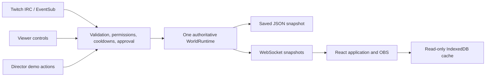

# HELLO WORLD

**Your community. A life of its own.** A livestream-powered 3D neighborhood where viewers become residents, meet their neighbors, and make a little history together.

This is an independent vertical slice of a persistent virtual society. All residents, interactions, demonstration events, Twitch actions, and OBS sessions use the same world runtime. No source or assets are borrowed from the owner's other projects.

## Online world

**[Open HELLO WORLD](https://hello-world-miles-society.myles4miles.chatgpt.site)** · [Director Studio](https://hello-world-miles-society.myles4miles.chatgpt.site/director) · [OBS browser source](https://hello-world-miles-society.myles4miles.chatgpt.site/overlay?camera=neighborhood)

The Site is owner-private and requires ChatGPT sign-in. OBS uses a separate browser context and also needs authenticated access; operation inside native OBS is unverified. The hosted world uses D1 and server-side Workers, without a local Node server. It remains **Demo Mode** until the Twitch app ID/secret are configured privately and the broadcaster authorizes. [Hosted Twitch callbacks, permissions and setup](docs/HOSTED_TWITCH.md).

## Run locally

Requires Node.js 22+ and pnpm 10.28+.

```bash
git clone https://github.com/mylife-as-miles/hello-world.git
cd hello-world
cp .env.example .env
pnpm install
pnpm dev
```

Open **http://localhost:5173**. The server runs at `http://localhost:3001`. The example configuration enables Director controls only for same-origin loopback connections. Open **Director Studio** to change atmosphere, launch demo events, moderate interactions, and prepare an OBS source.

Without authorized Twitch credentials, the application explicitly runs in **Demo Mode**. A demonstration is not a live Twitch connection.

```bash
pnpm typecheck
pnpm test
pnpm build
# With the app running, exercise real browser acceptance:
pnpm test:browser
# Serve the production build and API together:
WEB_ORIGIN=http://localhost:3001 pnpm start
```

For a remote host, set `WEB_ORIGIN` to the exact public application origin, set a private `DIRECTOR_KEY` of at least 16 characters, set `ALLOW_LOCAL_DIRECTOR=false`, use HTTPS/WSS through a reverse proxy, and keep the data directory on persistent disk. Do not expose the Vite development server as a production service.

## Explore

- **Discover / Enter World:** visit the neighborhood and see its current residents.
- **Create resident:** choose a name and appearance; the server assigns a stable signed browser identity.
- **Your world:** select residents, send greetings, wave, dance, give a gift, or start a friendship.
- **Director Studio:** weather, celebrations, demo raids, population limits, action cooldowns, approval queue, interaction pause, event history, and world reset.
- **OBS:** display the same world in a transparent browser source with configurable camera framing.

The browser identity and Twitch account identity are separate in this slice. Linking them into a single account is future work.

## Twitch

See [Twitch configuration and permissions](docs/TWITCH.md) and [verified integration research](docs/RESEARCH.md).

The local Node server uses Twurple with authenticated IRC for chat commands and EventSub WebSockets for subscriptions, approved reward redemptions, and incoming raids. Broadcaster authorization and the correct scopes are required; available capabilities and failures are reported honestly. Access tokens, refresh tokens, and client secrets remain on the server.

Commands: `!join`, `!wave`, `!dance`, `!hello`, `!gift username`.

Channel Points actions are mapped by approved reward ID. Chat text and redemption text never execute code. No live Twitch operation is claimed without an authorized broadcaster and real event verification.

## OBS browser source

1. Run the app and world server.
2. In OBS, add a **Browser** source.
3. Set URL to **http://localhost:5173/overlay?camera=neighborhood** for development, or `http://localhost:3001/overlay?camera=neighborhood` when using the production command.
4. Start with **1920 × 1080, 30 FPS**. Keep Browser Source's default transparent background CSS.

Camera choices: `neighborhood`, `orbit`, `street`, `follow`, `cinematic`. The generated URL preserves the selected resident for follow framing; `&resident=<resident-id>` can also be supplied. Add `&quality=low` for a lighter source. The app's OBS setup dialog generates the URL for the host currently in use. If OBS runs on another computer, use a reachable application URL configured as the server's `WEB_ORIGIN`.

Direct OBS WebSocket control is not included. Browser Source works independently of OBS remote-control permissions.

## Architecture and persistence



- `apps/web/`: React 19, TypeScript, Vite, product shell, Director Studio, OBS presentation, Dexie cache.
- `apps/server/`: Twurple, validated `ws` transport, server identity and permissions, snapshot persistence.
- `packages/contracts/`: stable versioned shared event, resident, appearance, scene, and runtime types.
- `packages/world-engine/`: Claude-owned 3D world, avatar creator, and life simulation.

The Node process owns the simulation. Multiple browsers receive the same authoritative state. The server saves snapshots atomically to its `.data` directory (by default the repository-root `.data` directory); the signing key and Twitch token file live there too. Keep this directory private, writable, and backed up. IndexedDB stores a read-only reconnect cache; it never overrides the server after a reset. Do not commit `.env` or `.data`.

The Node adapter does not claim distributed scaling or simulation while its process is stopped. The hosted Sites adapter persists shared state in D1 and advances simulation during active requests. A future Colyseus room can own the same runtime without changing normalized events or the scene interface. See [transport notes](docs/TRANSPORT.md).

## Integration and verification

[Integration contract v1](docs/INTEGRATION_CONTRACT.md) defines ownership and exact imports. Only Codex integrates into `main`; Claude's engine arrives through `claude/world-engine`.

[Browser and integration QA](docs/QA.md) records real checks and evidence. `pnpm test:browser` uses system Chromium when available; otherwise run `pnpm exec playwright install chromium` first. Set `QA_BROWSER_PATH` for a different executable, and `QA_DIRECTOR_KEY` when testing a key-protected server. [Independent critique](docs/CRITIQUE.md) records weighted scores and remaining problems. Live Twitch and OBS application tests require their respective external applications/permissions; browser-source rendering is tested in Chromium.

The engine v1 handoff is integrated. Workspace TypeScript, 80 automated tests, and the production build pass; browser and renderer evidence are recorded in the linked QA documents. Live Twitch and native OBS verification remain dependent on external access.

## WebGPU and hosted Sites

Use `/world?renderer=webgpu` or `/overlay?renderer=webgpu` to request WebGPU. The OBS setup dialog also selects the world renderer. WebGL remains the compatible default and fallback. The world, character studio, and overlay were verified using genuine software WebGPU; hardware performance and native OBS WebGPU are untested. WebGPU uses compatible materials/effects and omits WebGL-only postprocessing. See [WebGPU reproduction](docs/WEBGPU.md).

`pnpm build:sites` builds the HTTP-polling frontend and Cloudflare Worker artifact. The hosted adapter uses Sites identity and D1 with optimistic concurrency, preserving the same runtime/events. The Node WebSocket transport remains the default for `pnpm dev`. Hosted Demo Mode does not imply authorized Twitch delivery; simulation advances during active requests.
